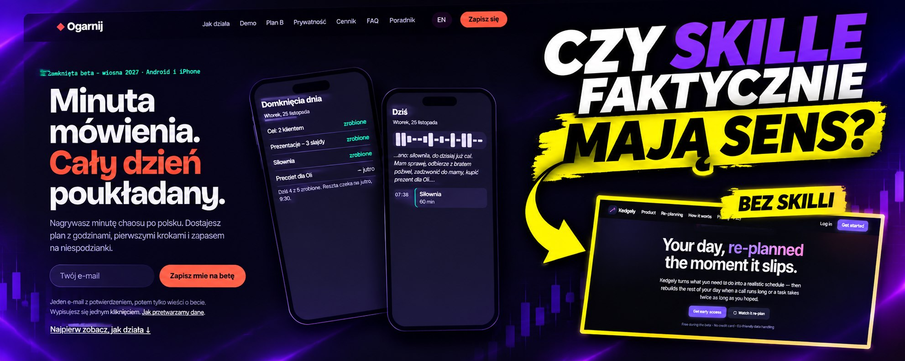
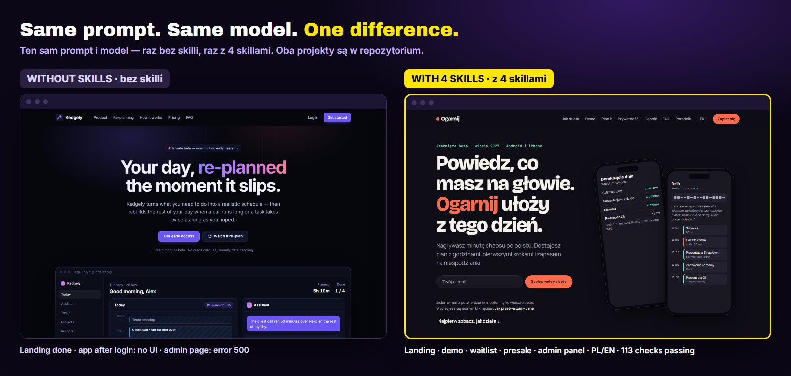
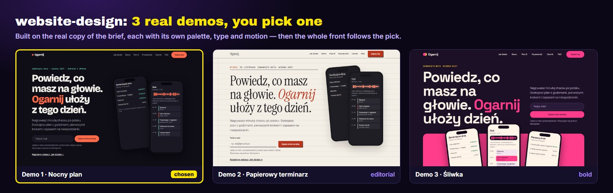
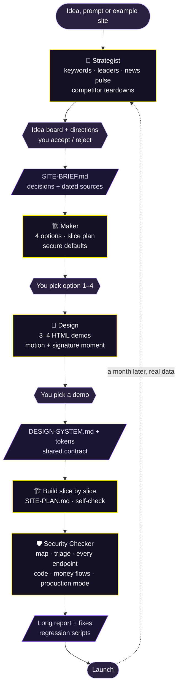

<p align="center">
  <a href="https://www.youtube.com/watch?v=mE5L9HQcvWk">
    
  </a>
</p>

<h1 align="center">Website Skills for Claude</h1>

<p align="center">
  <strong>4 cooperating Claude Code skills that take a website from a one-line idea to a researched, designed, built and security-audited launch.</strong>
  <br>
  Strategist → Maker → Design → Security Checker. Instructions in English, conversation and output in your language (tuned for Polish and the EU market).
</p>

<p align="center">
  <a href="README.pl.md">Polski</a>
  ·
  <a href="#the-test-same-prompt-with-and-without-skills">The test</a>
  ·
  <a href="#15-reasons-skills-beat-a-bare-prompt">15 reasons</a>
  ·
  <a href="#how-the-four-skills-work-together">How they work together</a>
  ·
  <a href="#how-the-security-checker-thinks">Security logic</a>
  ·
  <a href="#install">Install</a>
  ·
  <a href="CHANGELOG.md">Changelog</a>
</p>

<p align="center">
  
  
  
  
  <a href="https://www.youtube.com/watch?v=mE5L9HQcvWk"></a>
  <a href="LICENSE"></a>
</p>

---

Most AI-built websites fail in the same places: nobody researched what the category
needs, the look is the default purple gradient, the build stops half-way when the
context or the usage runs out, and nobody checks whether a visitor can read someone
else's data or "pay" without paying. These four skills turn those gaps into steps the
model **has to** go through — with stop points where **you** decide.

| | Skill | In one line |
|---|---|---|
| 🧭 | [**website-strategist**](website-strategist/) | from an idea: keyword map, category leaders, what moved in the news, competitor teardowns → ideas and directions **you accept** → `SITE-BRIEF.md` |
| 🏗️ | [**website-maker**](website-maker/) | 4 build options to choose from, a build plan in vertical slices that survives interruptions, secure defaults learned from real audits |
| 🎨 | [**website-design**](website-design/) | 3–4 real HTML demos side by side, each with its own motion and signature moment → the whole front redesigned consistently |
| 🛡️ | [**website-security-checker**](website-security-checker/) | maps every page and connection, triages the 20 classic failures, tests every endpoint, reads the code, proves payments, writes a long report |

> The folder READMEs are in Polish. `SKILL.md` files (what the model reads) are in English.

## The test: same prompt, with and without skills

One prompt, one model, two folders. First build without any skills; second build with
the four skills in order (strategist → maker + design → security checker). Then the
same security skill audited both. Full walkthrough on
**[YouTube](https://www.youtube.com/watch?v=mE5L9HQcvWk)**.

<p align="center">
  
</p>

| | Without skills — [`bez skilli/`](bez%20skilli/) | With 4 skills — [`z skillami/`](z%20skillami/) |
|---|---|---|
| Process | straight to code | brief with research → 4 options → 3 design demos → build → audit |
| What exists | landing page and a complete backend (68 endpoints); **after login the app has no UI and the admin page returns 500** — usage ran out mid-build | landing with an in-browser demo, waitlist with referrals, presale (sandbox / Stripe), admin panel with roles and 2FA, PL/EN, PWA |
| Automated checks | none (audit finding C1) | 46 unit/integration tests + 67 checks in a real browser |
| Security audit (same skill) | 25 findings: 0 critical, 2 high (the missing UI), 8 medium | 26 findings over two passes: 0 critical, 1 high — 16 fixed and retested |
| Design | one look, chosen by the model | 3 demos, owner picked one |

This is one run, not a benchmark — both projects are in the repo so you can judge for
yourself. What the test changed in the skills is in [CHANGELOG.md](CHANGELOG.md): the
maker now plans in vertical slices (so an interruption never leaves a backend without a
UI again), and both builds' 51 findings became the maker's secure defaults.

<p align="center">
  
</p>

## 15 reasons skills beat a bare prompt

1. **The method survives a long conversation.** A prompt fades as the context fills up;
   a skill is re-read at every step, and its state lives in files (`SITE-PLAN.md`,
   `SITE-BRIEF.md`, the report's *Stan audytu* block). A new session continues from
   "next step" instead of starting over.
2. **Interruptions don't leave half a product.** The maker builds in vertical slices —
   page → form → API → database → e-mail → admin view — so something works in the
   browser from the first slice. Without skills, the test build finished 68 endpoints
   and no UI.
3. **Research before code, with dates.** The strategist builds a keyword map, finds
   category leaders and fast risers, reads the last 3–6 months of news and tears down
   competitors' real pages. A bare prompt relies on what the model half-remembers.
4. **It asks what you didn't know to ask.** Requirements come from four sources: your
   wishes, what every site needs, what this type of site needs, what leaders have —
   with "🔥 proposals outside your list" at the top.
5. **You decide, and decisions stick.** Ideas are accepted or rejected on an idea board;
   rejected ones are never proposed again, accepted ones become requirements with
   acceptance criteria.
6. **You choose with your eyes.** 3–4 HTML demos on your real copy, side by side,
   desktop and phone — instead of describing a look with adjectives and getting the
   default one.
7. **Anti-AI-slop is a checklist, not a hope.** 18 slop tells, a 40-point craft pass and
   a script that finds hard-coded colours, off-scale sizes and font chaos.
8. **A design system, not a pile of pages.** Maker and design share one token contract,
   so every page, component and state stays consistent — and later changes don't break
   it.
9. **Motion designed like a studio does it.** A motion personality, three layers,
   one signature moment that shows the product, modern CSS (scroll-driven animations,
   View Transitions, `@starting-style`) and performance and accessibility gates.
10. **Secure by default, not by luck.** The maker's defaults come from 51 real findings:
    features fail closed when a key is missing, prices and roles are decided on the
    server, payment status only from verified webhooks, single-use codes reserved
    atomically.
11. **An auditor that maps before it tests.** Every page, endpoint, webhook and third
    party goes into a catalogue and gets a result; nothing is "sampled" silently.
12. **Deterministic tools where precision matters.** Zero-dependency Node scripts map
    routes with their mount prefixes, run a safe multi-role IDOR matrix, scan a live
    site passively and audit CSS consistency — reproducible and cheap in tokens.
13. **Evidence instead of vibes.** Every finding is *confirmed* (request and response,
    or code plus a run) or marked *to be confirmed*; every strategic claim has a dated
    source; reviews, numbers and logos are never invented.
14. **Market and legal reality built in.** GDPR/RODO, cookie consent, EU Omnibus
    pricing, the European Accessibility Act, GPSR, KSeF, BLIK and Polish gateways,
    the EU ban on fake urgency and fake reviews.
15. **A skill gets better; a prompt gets lost.** Skills are versioned files you can
    share with a team and improve after every project — version 2 of this pack came
    straight out of the test above.

## How the four skills work together



- **Strategist → maker:** `SITE-BRIEF.md` in a fixed format. The maker doesn't re-ask or
  re-research, treats your decisions as binding and pre-fills its four options.
- **Design ↔ maker:** one token contract (`DESIGN-SYSTEM.md`, `tokens.css`, motion
  tokens included), so the chosen demo becomes the real site without drift.
- **Maker → security:** a 10-step self-check while building, the full audit before
  launch (options 2–4).
- **After launch → strategist:** a growth audit on real traffic.
- Each skill also works alone; the built-in references cover the others' ground in a
  lighter form.

## 🧭 Website Strategist

From one sentence to a brief that reads like a top agency wrote it — and is up to date.
1. **Decode the idea:** a one-line thesis, the category in local and English terms (they
   lead to different sources), buyer vs user, and the category type (new, crowded,
   local, commodity, high-trust), which decides what the site must do first.
2. **Keyword map** in four rings: category, problem, solution, comparison.
3. **Leaders, risers, design benchmarks** — 5–10 sites with a reason for each.
4. **News pulse** of the last 3–6 months: launches, pricing changes, regulation,
   platform shifts, incidents — each with a source, date, status and a decision: ride
   it, answer the fear it created, or avoid it.
5. **Teardown cards** of the leaders' real pages and a feature matrix, plus their
   1–3 star reviews — the cheapest source of differentiators.
6. **Category standard, differentiators, gaps, audience questions.**
7. **Idea board** through ten lenses and **2–3 strategic directions** (plus product
   directions when the research shows them). **You accept or reject**, then it writes
   `SITE-BRIEF.md` for the maker or a 3 000–8 000-word prompt for any other AI.

## 🏗️ Website Maker

- Four options of growing scope: **1 front**, **2 + backend**, **3 + admin and
  payments**, **4 ultimate** — each concrete for your business, with extras you didn't
  ask for at the top.
- **Build plan in vertical slices** with an API contract and data model written before
  code, a definition of done per slice and a resumable `SITE-PLAN.md`.
- **Secure skeleton from the first commit** (`.gitignore` for env, data and databases,
  startup config that fails closed, headers, limits) and **secure defaults** in every
  backend feature.
- Design phase through website-design, real copy (no invented reviews or stats),
  browser verification at four widths, Core Web Vitals, SEO and a launch checklist.

## 🎨 Website Design

- **3–4 HTML demos** on your real content, genuinely different in type, palette, layout
  and **motion personality**, each with one **signature moment** that shows the product
  or the result. Opened side by side with a desktop/phone toggle.
- Pick or mix ("colours from 2, type from 3, motion from 1") → the **whole front** is
  replaced in order: tokens, base, components, sections, pages, motion layer, cleanup.
- Works the way top front-end engineers and studios do (Refactoring UI, Josh Comeau,
  Emil Kowalski, Rauno Freiberg, Every Layout, Utopia, Defensive CSS, Jhey Tompkins,
  Bramus Van Damme, Linear/Stripe/Vercel): modern CSS motion with code, a 40-point
  craft pass, performance and accessibility gates, a consistency-audit script.

## 🛡️ Website Security Checker

A pentester and a code reviewer in one, for sites you own or may test. Ten phases from
inventory to fixes, three zero-dependency scripts, a long report in your language.

## How the security checker thinks

1. **Map first, then test.** A checklist run blind misses the forgotten
   `/api/admin/export` or the Supabase table with RLS off. The audit starts with an
   inventory of everything — pages, every endpoint, webhook, socket, cron, third party,
   config and modes.
2. **Triage the usual killers within minutes.** 20 failures that sink quickly built
   (often AI-built) sites: secrets in the frontend, a BaaS open to the world, API routes
   without auth, client-only checks, IDOR, middleware-only protection, known framework
   CVEs, sandbox payments live in production, prices from the client, credential files
   in the repo… **Critical findings reach you immediately**, not at the end.
3. **Every connection, not a sample.** Each endpoint is tested per role (guest, user A,
   user B, admin) for auth, object access, methods, validation, injection, malformed
   input, data exposure, CORS, CSRF, limits, caching and errors — and gets a result.
4. **Attacker and reviewer at once.** The frontend from an attacker's chair, threat
   scenarios for *this* site, a code review for security **and** plain logic bugs —
   money in floats, time zones, races, `"false"` saved as consent.
5. **Money paths proven three ways:** wired, logical in every path, impossible to tamper
   with.
6. **Production configuration.** The app runs locally as in production: complete, with
   a payment key missing, behind a proxy. Everything must fail closed.
7. **A second pass with fresh eyes** before the report: what features *also* allow.
   In the test, this pass found 7 issues the first one missed.
8. **Evidence or "to be confirmed",** a coverage gate, and a report written **from
   minute one** — if the session stops, the next one continues from the next step.

Safe by design: authorized targets only, no DoS or mass brute force, payments only in
sandbox, state-changing tests on local/staging data, leaks confirmed minimally and
never downloaded, secrets redacted. The role matrix never sends credentials to another
host and skips GET routes that change state.

## Install

**Claude Code** — copy the four folders to your skills directory:

```bash
git clone https://github.com/3godzinyL/Custom-website-skills-.git
cp -r Custom-website-skills-/website-* ~/.claude/skills/          # all projects
# or: cp -r Custom-website-skills-/website-* .claude/skills/       # one project
```

```powershell
# Windows
Copy-Item -Recurse .\Custom-website-skills-\website-* "$env:USERPROFILE\.claude\skills\"
```

**Claude.ai / Claude app** — zip each skill folder separately (the zip contains the
folder with `SKILL.md`) and add it in *Settings → Capabilities → Skills*. MCP servers go
in *Settings → Connectors*.

**Other AI tools** — paste the `SKILL.md` as instructions and attach files from
`references/` when the step needs them.

Then just talk: *"I have an idea for a voice day-planner app — research it and write a
brief"*, *"build option 3 from SITE-BRIEF.md"*, *"make 3 design demos for my site"*,
*"audit my shop, the code is in ./shop"*. Or call a skill by name, e.g.
`/website-design`. Polish works out of the box: *„zrób stronę”*, *„sprawdź
bezpieczeństwo strony”*, *„co jest na topie w mojej branży”*.

**Requirements:** Node.js 18+ for the scripts and default builds. Optional: web access
(research, live tests), a browser tool or Playwright MCP (screenshots, visual checks).
The skills *suggest* MCP servers (Playwright, Supabase, Stripe, Semgrep, Firecrawl…)
with a reason and an install command — they never install anything themselves.

## What's inside

```
├── website-strategist/        SKILL.md · README.md · references/ (10)
├── website-maker/             SKILL.md · README.md · references/ (10)
├── website-design/            SKILL.md · README.md · references/ (13) · assets/ · scripts/
├── website-security-checker/  SKILL.md · README.md · references/ (12) · scripts/ (3)
├── bez skilli/                the test build without skills + its audit
├── z skillami/                the test build with skills + its audit, brief, plan, demos
└── assets/                    banner and images for this README
```

## FAQ

**Do I need all four?**
No. Each works alone; together they hand off through files.

**Is the security checker an attack tool?**
No — it is for sites you own or are authorized to test, and it stays non-destructive
by default.

**Only for Polish sites?**
No. The skills talk in your language; Polish/EU law and payment methods are simply
covered in depth.

**Does it replace a professional pentest?**
It finds most of what small and AI-built sites get wrong, with evidence. For high-risk
systems, use it before a professional test, not instead of one.

**Will it install MCP servers or other tools on my machine?**
No. It suggests them once, with a reason and the command, and continues without them
if you say no.

---

<p align="center">
  If the comparison convinced you, a ⭐ helps other people find these skills.
  <br>
  <sub>Use the security checker only on sites you own or may test. Legal checklists are build checklists, not legal advice.</sub>
</p>
