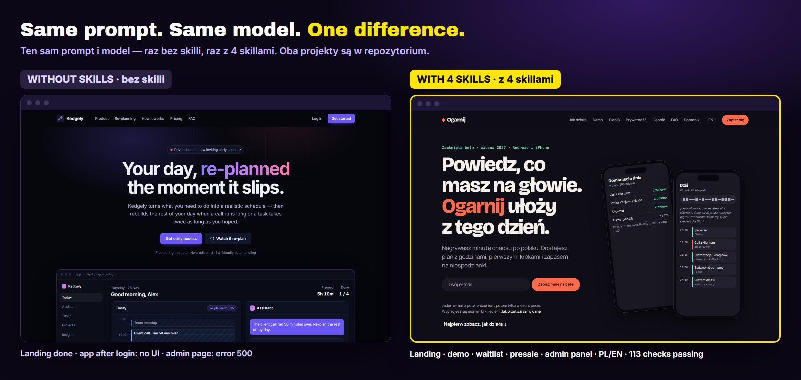
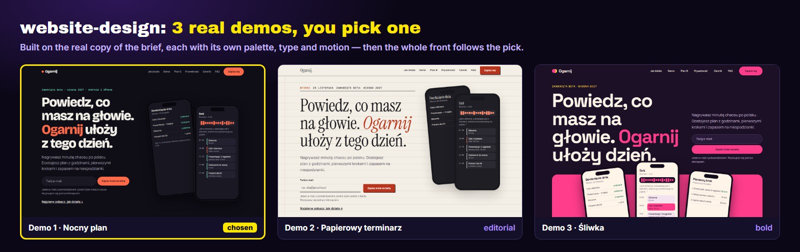
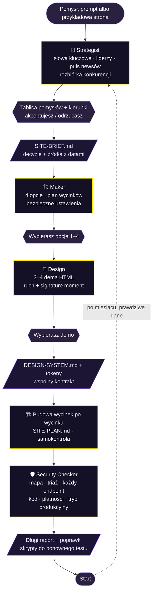

<p align="center">
  <a href="https://www.youtube.com/watch?v=mE5L9HQcvWk">
    
  </a>
</p>

<h1 align="center">Skille do budowy stron dla Claude</h1>

<p align="center">
  <strong>4 współpracujące skille do Claude Code, które prowadzą stronę od jednego zdania pomysłu do zbadanej, zaprojektowanej, zbudowanej i sprawdzonej pod kątem bezpieczeństwa premiery.</strong>
  <br>
  Strategist → Maker → Design → Security Checker. Instrukcje po angielsku, rozmowa i wyniki w Twoim języku (dopracowane pod Polskę i rynek UE).
</p>

<p align="center">
  <a href="README.md">English</a>
  ·
  <a href="#test-ten-sam-prompt-z-skillami-i-bez">Test</a>
  ·
  <a href="#15-powodów-dla-których-skille-wygrywają-z-samym-promptem">15 powodów</a>
  ·
  <a href="#jak-współpracują-cztery-skille">Współpraca</a>
  ·
  <a href="#jak-myśli-security-checker">Logika bezpieczeństwa</a>
  ·
  <a href="#instalacja">Instalacja</a>
  ·
  <a href="CHANGELOG.md">Zmiany</a>
</p>

<p align="center">
  
  
  
  
  <a href="https://www.youtube.com/watch?v=mE5L9HQcvWk"></a>
  <a href="LICENSE"></a>
</p>

---

Większość stron zbudowanych przez AI sypie się w tych samych miejscach: nikt nie
sprawdził, czego potrzebuje dana kategoria, wygląd to domyślny fioletowy gradient,
budowa staje w połowie, gdy kończy się kontekst albo limit, a nikt nie sprawdza, czy
odwiedzający odczyta cudze dane albo „zapłaci” bez płacenia. Te cztery skille
zamieniają te luki w kroki, przez które model **musi** przejść — z punktami, w których
**decydujesz Ty**.

| | Skill | W jednym zdaniu |
|---|---|---|
| 🧭 | [**website-strategist**](website-strategist/) | z pomysłu: mapa słów kluczowych, liderzy kategorii, co działo się w newsach, rozbiórka stron konkurencji → pomysły i kierunki **do Twojej akceptacji** → `SITE-BRIEF.md` |
| 🏗️ | [**website-maker**](website-maker/) | 4 opcje budowy do wyboru, plan w pionowych wycinkach odporny na przerwanie, bezpieczne ustawienia z prawdziwych audytów |
| 🎨 | [**website-design**](website-design/) | 3–4 prawdziwe dema HTML obok siebie, każde z własnym ruchem i „signature moment” → spójna podmiana całego frontu |
| 🛡️ | [**website-security-checker**](website-security-checker/) | mapa każdej strony i połączenia, triaż 20 klasycznych wpadek, test każdego endpointu, przegląd kodu, płatności, długi raport |

> README w folderach skilli są po polsku. Pliki `SKILL.md` (to, co czyta model) są po angielsku, bo modele wykonują je wtedy najdokładniej.

## Test: ten sam prompt z skillami i bez

Jeden prompt, jeden model, dwa foldery. Najpierw budowa bez żadnych skilli, potem
z czterema skillami po kolei (strategist → maker + design → security checker). Na
końcu ten sam skill bezpieczeństwa sprawdził oba projekty. Pełne podsumowanie
na **[YouTube](https://www.youtube.com/watch?v=mE5L9HQcvWk)**.

<p align="center">
  
</p>

| | Bez skilli — [`bez skilli/`](bez%20skilli/) | Z 4 skillami — [`z skillami/`](z%20skillami/) |
|---|---|---|
| Przebieg | od razu kod | brief z researchem → 4 opcje → 3 dema designu → budowa → audyt |
| Co powstało | landing i kompletny backend (68 endpointów); **po zalogowaniu aplikacja nie ma interfejsu, a panel admina zwraca błąd 500** — w trakcie budowy skończył się limit | landing z demem działającym w przeglądarce, lista oczekujących z poleceniami, przedsprzedaż (sandbox / Stripe), panel z rolami i 2FA, PL/EN, PWA |
| Automatyczne testy | brak (problem C1 w audycie) | 46 testów jednostkowych i integracyjnych + 67 sprawdzeń w prawdziwej przeglądarce |
| Audyt bezpieczeństwa (ten sam skill) | 25 problemów: 0 krytycznych, 2 wysokie (brak interfejsu), 8 średnich | 26 problemów w dwóch przebiegach: 0 krytycznych, 1 wysoki — 16 naprawionych i sprawdzonych ponownie |
| Design | jeden wygląd, wybrany przez model | 3 dema, wybór właściciela |

To jeden przebieg, a nie benchmark — oba projekty są w repozytorium, więc możesz
ocenić to samodzielnie. Co test zmienił w skillach, opisuje [CHANGELOG.md](CHANGELOG.md): maker planuje
teraz budowę w pionowych wycinkach (przerwanie już nigdy nie zostawi backendu bez
interfejsu), a 51 problemów z obu projektów stało się bezpiecznymi ustawieniami
domyślnymi makera.

<p align="center">
  
</p>

## 15 powodów, dla których skille wygrywają z samym promptem

1. **Metoda przetrwa długą rozmowę.** Prompt blednie, gdy kontekst się zapełnia. Skill
   jest czytany na każdym kroku, a stan pracy żyje w plikach (`SITE-PLAN.md`,
   `SITE-BRIEF.md`, blok „Stan audytu” w raporcie). Nowa sesja zaczyna od „następnego
   kroku”, a nie od zera.
2. **Przerwanie nie zostawia pół produktu.** Maker buduje w pionowych wycinkach —
   strona → formularz → API → baza → e-mail → widok w panelu — więc coś działa
   w przeglądarce od pierwszego wycinka. Bez skilli test skończył się na 68 endpointach
   i zerze interfejsu.
3. **Research przed kodem, z datami.** Strategist robi mapę słów kluczowych, szuka
   liderów i szybko rosnących, czyta newsy z ostatnich 3–6 miesięcy i rozbiera prawdziwe
   strony konkurencji. Sam prompt opiera się na tym, co model pamięta jak przez mgłę.
4. **Pyta o to, o czym łatwo zapomnieć.** Wymagania z czterech źródeł:
   Twoje życzenia, to, co musi mieć każda strona, to, co musi mieć ten typ strony, i to,
   co mają liderzy — z „🔥 Propozycjami spoza Twojej listy” na samej górze.
5. **Decydujesz Ty, a decyzje zostają.** Pomysły akceptujesz albo odrzucasz na tablicy;
   odrzuconych skill nigdy nie proponuje ponownie, zaakceptowane stają się wymaganiami
   z kryteriami akceptacji.
6. **Wybierasz oczami.** 3–4 dema HTML na Twoich prawdziwych treściach, obok siebie,
   na komputerze i telefonie — zamiast opisywać wygląd przymiotnikami i dostać ten
   domyślny.
7. **Antyslop to checklista, a nie nadzieja.** 18 objawów AI slopu, 40-punktowy przegląd
   detali i skrypt, który znajduje kolory wpisane na sztywno, rozmiary spoza skali
   i chaos fontów.
8. **System designu, a nie stos stron.** Maker i design dzielą jeden kontrakt tokenów,
   więc każda strona, komponent i stan są spójne — a późniejsze zmiany nic nie psują.
9. **Ruch projektowany jak w studiu.** Charakter ruchu, trzy warstwy, jeden „signature
   moment”, który pokazuje produkt, nowoczesny CSS (animacje sterowane przewijaniem,
   View Transitions, `@starting-style`) oraz bramki wydajności i dostępności.
10. **Bezpieczeństwo domyślnie, a nie przypadkiem.** Ustawienia makera pochodzą z 51
    prawdziwych problemów: funkcja bez klucza się wyłącza, a nie udaje, ceny i role
    decyduje serwer, płatność tylko z podpisanego webhooka, jednorazowe kody rezerwowane
    atomowo.
11. **Audytor, który najpierw robi mapę.** Każda strona, endpoint, webhook i usługa
    zewnętrzna trafia do katalogu i dostaje wynik; nic nie jest „próbkowane” po cichu.
12. **Deterministyczne narzędzia tam, gdzie liczy się precyzja.** Skrypty Node bez
    zależności mapują trasy z prefiksami, puszczają bezpieczną macierz ról (IDOR),
    skanują stronę pasywnie i sprawdzają spójność CSS — powtarzalnie i tanio w tokenach.
13. **Dowody zamiast przeczuć.** Każdy problem jest *potwierdzony* (żądanie i odpowiedź
    albo kod i uruchomienie) albo oznaczony *do potwierdzenia*; każde twierdzenie
    strategiczne ma źródło z datą; opinii, liczb i logotypów się nie wymyśla.
14. **Rynek i prawo w środku.** RODO, zgody na cookies, Omnibus, Europejski Akt
    o Dostępności, GPSR, KSeF, BLIK i polskie bramki płatności, unijny zakaz fałszywej
    presji czasu i fałszywych opinii.
15. **Skill się ulepsza, prompt ginie.** Skille to wersjonowane pliki, które można
    dać zespołowi i poprawiać po każdym projekcie — wersja 2 tej paczki wyszła wprost
    z testu powyżej.

## Jak współpracują cztery skille



- **Strategist → maker:** `SITE-BRIEF.md` w stałym formacie. Maker nie pyta drugi raz
  i nie powtarza researchu, Twoje decyzje traktuje jako wiążące i wypełnia z nich swoje
  4 opcje.
- **Design ↔ maker:** jeden kontrakt tokenów (`DESIGN-SYSTEM.md`, `tokens.css`, także
  tokeny ruchu), więc wybrane demo staje się prawdziwą stroną bez rozjazdów.
- **Maker → security:** samokontrola w 10 krokach w trakcie budowy, pełny audyt przed
  startem (opcje 2–4).
- **Po starcie → strategist:** audyt rozwoju na prawdziwym ruchu.
- Każdy skill działa też sam; wbudowane materiały pokrywają w lżejszej formie to, co
  robią pozostałe.

## 🧭 Website Strategist

Z jednego zdania do briefu, który wygląda, jakby napisała go dobra agencja — i jest
aktualny.
1. **Rozszyfrowanie pomysłu:** teza strony w jednym zdaniu, kategoria po polsku i po
   angielsku (prowadzą do innych źródeł), kupujący i użytkownik, typ kategorii (nowa,
   zatłoczona, usługa lokalna, sklep, wysokie zaufanie), który decyduje, co strona musi
   zrobić najpierw.
2. **Mapa słów kluczowych** w czterech kręgach: kategoria, ból, rozwiązanie, porównania.
3. **Liderzy, szybko rosnący, wzorce designu** — 5–10 stron, przy każdej powód.
4. **Puls newsów** z ostatnich 3–6 miesięcy: premiery, zmiany cen, prawo, zmiany
   platform, wpadki — każdy sygnał ze źródłem, datą, statusem i decyzją: wykorzystać,
   odpowiedzieć na obawę albo unikać.
5. **Karty rozbiórki** prawdziwych stron liderów i macierz funkcji, a do tego ich
   opinie 1–3★, czyli najtańsze źródło przewag.
6. **Standard kategorii, wyróżniki, luki, pytania odbiorców.**
7. **Tablica pomysłów** z dziesięciu perspektyw i **2–3 kierunki strony** (a gdy
   research to pokaże, także kierunki rozwoju produktu). **Akceptujesz albo
   odrzucasz**, a potem powstaje `SITE-BRIEF.md` dla makera albo prompt na 3–8 tys. słów
   dla dowolnego innego AI.

## 🏗️ Website Maker

- Cztery opcje rosnącego zakresu: **1 front**, **2 + backend**, **3 + panel i płatności**,
  **4 tryb ostateczny** — każda konkretna dla Twojego biznesu, z propozycjami spoza
  Twojej listy na górze.
- **Plan budowy w pionowych wycinkach**: kontrakt API i model danych przed kodem,
  definicja ukończenia każdego wycinka i `SITE-PLAN.md`, od którego można wznowić pracę.
- **Bezpieczny szkielet od pierwszego commita** (`.gitignore` dla env, danych i baz,
  konfiguracja, która przy braku klucza się zamyka, nagłówki, limity) i **bezpieczne
  ustawienia domyślne** w każdej funkcji backendu.
- Faza designu przez website-design, prawdziwe treści (bez wymyślonych opinii
  i liczb), sprawdzenie w przeglądarce na 4 szerokościach, Core Web Vitals, SEO
  i checklista publikacji.

## 🎨 Website Design

- **3–4 dema HTML** na Twoich prawdziwych treściach, naprawdę różne typografią,
  paletą, układem i **charakterem ruchu**, każde z jednym **signature moment**, który
  pokazuje produkt albo efekt. Otwierane obok siebie z przełącznikiem komputer/telefon.
- Wybierasz albo łączysz („kolory z 2, typografia z 3, ruch z 1”) → podmieniany jest
  **cały front** w kolejności: tokeny, baza, komponenty, sekcje, strony, warstwa ruchu,
  sprzątanie.
- Pracuje jak najlepsi frontendowcy i studia (Refactoring UI, Josh Comeau, Emil
  Kowalski, Rauno Freiberg, Every Layout, Utopia, Defensive CSS, Jhey Tompkins, Bramus
  Van Damme, Linear/Stripe/Vercel): nowoczesny CSS ruchu z kodem, 40-punktowy przegląd
  detali, bramki wydajności i dostępności, skrypt audytu spójności.

## 🛡️ Website Security Checker

Pentester i code reviewer w jednym, dla stron Twoich albo takich, na których test masz
zgodę. Dziesięć faz od inwentaryzacji do poprawek, trzy skrypty bez zależności, długi
raport po polsku.

## Jak myśli security checker

1. **Najpierw mapa, potem testy.** Checklista odpalona „w ciemno” pomija zapomniany
   `/api/admin/export` albo tabelę Supabase bez RLS. Audyt zaczyna się od inwentaryzacji
   wszystkiego: stron, każdego endpointu, webhooka, socketu, crona, usługi zewnętrznej,
   konfiguracji i trybów.
2. **Triaż typowych zabójców w kilkanaście minut.** 20 wpadek, które kładą szybko
   budowane (często przez AI) strony: sekrety we froncie, baza otwarta dla świata, API
   bez logowania, sprawdzanie tylko w przeglądarce, IDOR, ochrona tylko w middleware,
   znane CVE frameworków, sandbox płatności na produkcji, ceny z przeglądarki, pliki
   z hasłami w repo… **Krytyczne problemy trafiają do Ciebie od razu**, a nie na końcu.
3. **Każde połączenie, nie próbka.** Każdy endpoint jest testowany dla każdej roli
   (gość, użytkownik A, użytkownik B, admin): logowanie, dostęp do obiektów, metody,
   walidacja, injection, zniekształcone dane, wycieki, CORS, CSRF, limity, cache
   i błędy — i dostaje wynik.
4. **Atakujący i recenzent naraz.** Front oczami atakującego, scenariusze zagrożeń dla
   *tej* strony, przegląd kodu pod kątem bezpieczeństwa **i** zwykłych błędów
   logicznych — pieniądze na floatach, strefy czasowe, wyścigi, `"false"` zapisane jako
   zgoda.
5. **Płatności sprawdzone na trzy sposoby:** podłączone, logiczne w każdej ścieżce
   i niemożliwe do oszukania.
6. **Konfiguracja produkcyjna.** Aplikacja uruchomiona lokalnie jak na produkcji: pełna,
   bez klucza płatności, za proxy. Wszystko ma się zamykać.
7. **Drugie przejście świeżym okiem** przed raportem: na co funkcje *jeszcze* pozwalają.
   W teście to przejście znalazło 7 problemów, których nie było w pierwszym.
8. **Dowód albo „do potwierdzenia”**, bramka pokrycia i raport pisany **od pierwszej
   minuty** — gdy sesja się urwie, następna kontynuuje od następnego kroku.

Bezpieczny z założenia: tylko strony, na których test masz zgodę, bez DoS i masowego
brute force, płatności tylko w sandboxie, testy zmieniające dane na danych
lokalnych/stagingowych, wycieki potwierdzane minimalnie i nigdy nie pobierane, sekrety
maskowane. Macierz ról nigdy nie wysyła danych logowania na inny host i pomija GET-y,
które coś zmieniają.

## Instalacja

**Claude Code** — skopiuj cztery foldery do katalogu skilli:

```bash
git clone https://github.com/3godzinyL/Custom-website-skills-.git
cp -r Custom-website-skills-/website-* ~/.claude/skills/          # wszystkie projekty
# albo: cp -r Custom-website-skills-/website-* .claude/skills/     # jeden projekt
```

```powershell
# Windows
Copy-Item -Recurse .\Custom-website-skills-\website-* "$env:USERPROFILE\.claude\skills\"
```

**Claude.ai / aplikacja Claude** — spakuj każdy folder skilla osobno do ZIP-a (w środku
ma być folder z `SKILL.md`) i dodaj go w *Settings → Capabilities → Skills*. MCP
dodajesz w *Settings → Connectors*.

**Inne AI** — wklej treść `SKILL.md` jako instrukcję, a pliki z `references/` dołącz
wtedy, gdy dany krok ich potrzebuje.

Potem po prostu pisz: *„mam pomysł na aplikację do planowania dnia głosem, zrób radar
i brief”*, *„buduj opcję 3 z SITE-BRIEF.md”*, *„zrób 3 dema wyglądu mojej strony”*,
*„sprawdź bezpieczeństwo mojego sklepu, kod jest w ./sklep”*. Możesz też wywołać skill
po nazwie, np. `/website-design`.

**Wymagania:** Node.js 18+ dla skryptów i domyślnych projektów. Opcjonalnie: dostęp do
internetu (research, testy na żywo), narzędzie przeglądarki albo Playwright MCP (zrzuty,
kontrola wyglądu). Skille *proponują* MCP (Playwright, Supabase, Stripe, Semgrep,
Firecrawl…) z uzasadnieniem i komendą instalacji — nigdy niczego nie instalują same.

## Co jest w środku

```
├── website-strategist/        SKILL.md · README.md · references/ (10)
├── website-maker/             SKILL.md · README.md · references/ (10)
├── website-design/            SKILL.md · README.md · references/ (13) · assets/ · scripts/
├── website-security-checker/  SKILL.md · README.md · references/ (12) · scripts/ (3)
├── bez skilli/                projekt testowy bez skilli + jego audyt
├── z skillami/                projekt testowy z skillami + audyt, brief, plan, dema
└── assets/                    banner i grafiki do README
```

## FAQ

**Czy potrzebuję wszystkich czterech?**
Nie. Każdy działa sam, a razem przekazują sobie pracę przez pliki.

**Czy security checker to narzędzie do ataków?**
Nie — jest do stron Twoich albo takich, na których test masz zgodę, i domyślnie
niczego nie niszczy.

**Czy tylko do polskich stron?**
Nie. Skille rozmawiają w Twoim języku; polskie i unijne prawo oraz metody płatności są
po prostu opisane szczegółowo.

**Czy zastępuje profesjonalny pentest?**
Znajduje większość tego, co małe i budowane przez AI strony robią źle, z dowodami. Przy
systemach wysokiego ryzyka używaj go przed profesjonalnym testem, a nie zamiast niego.

**Czy zainstaluje mi MCP albo inne narzędzia?**
Nie. Proponuje je raz, z powodem i komendą, a gdy odmówisz, pracuje dalej bez nich.

---

<p align="center">
  Jeśli porównanie Cię przekonało, ⭐ pomoże innym znaleźć te skille.
  <br>
  <sub>Security checkera używaj tylko na stronach Twoich albo takich, na których test masz zgodę. Listy prawne to checklisty do budowy, a nie porada prawna.</sub>
</p>
